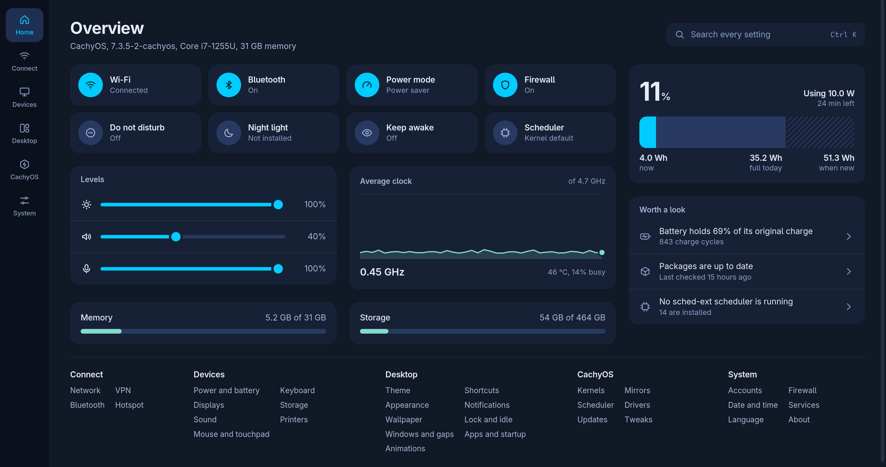
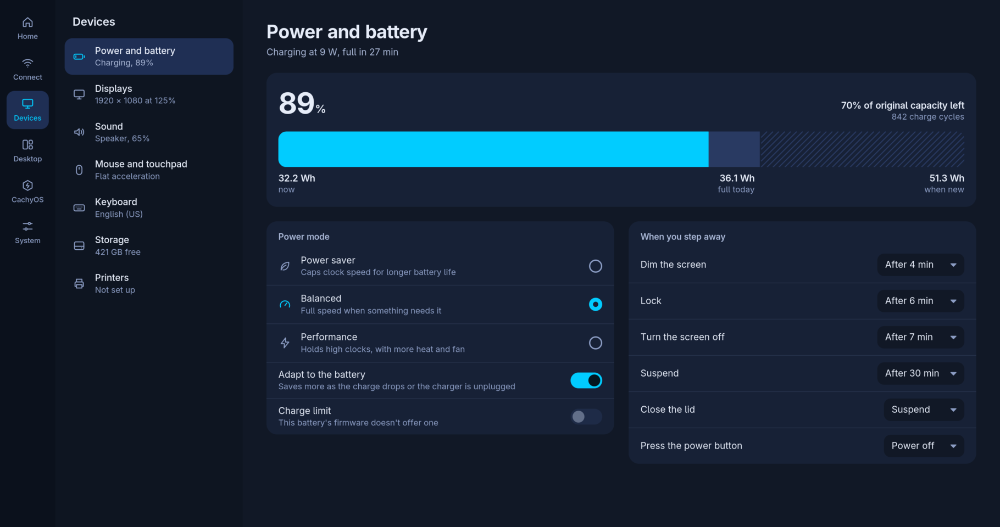
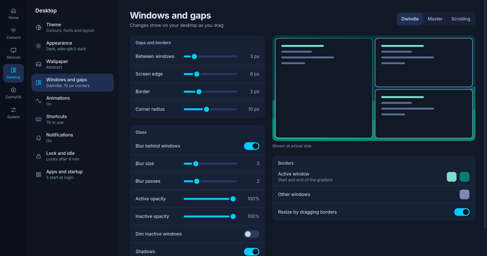
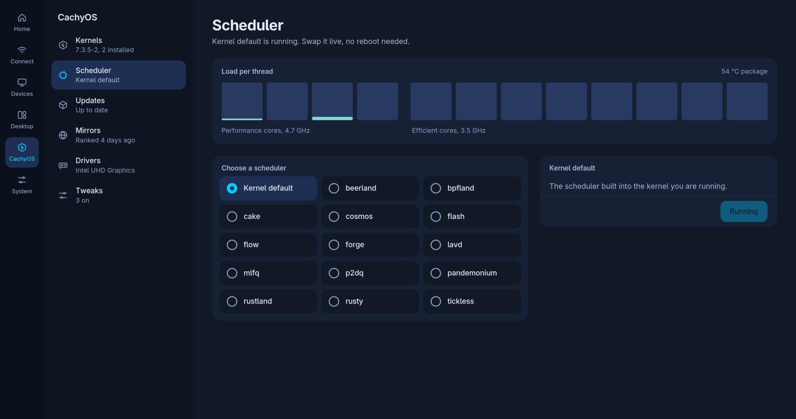
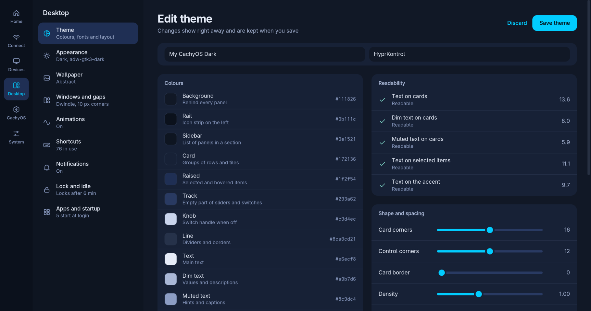
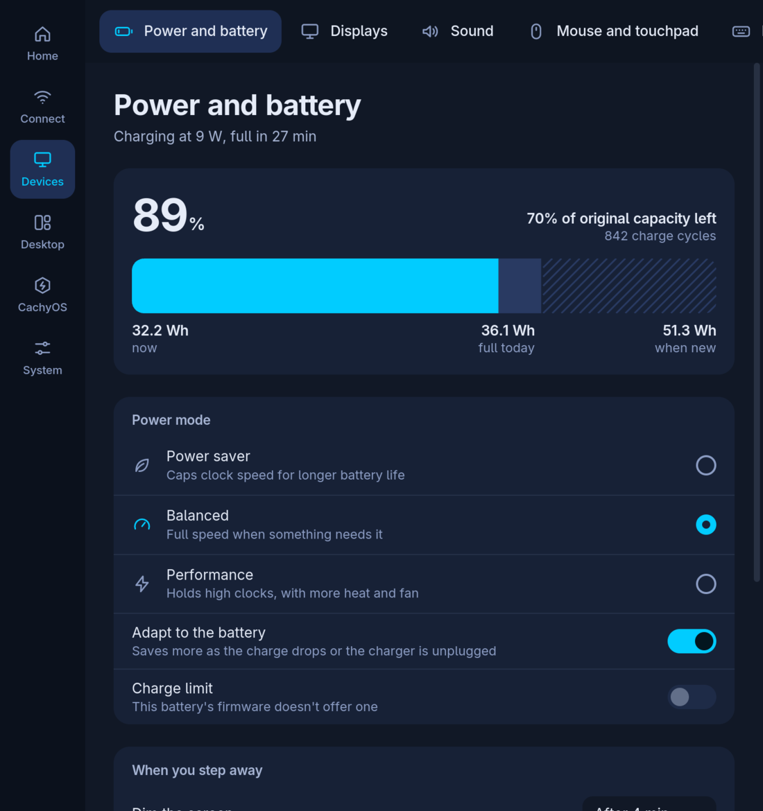
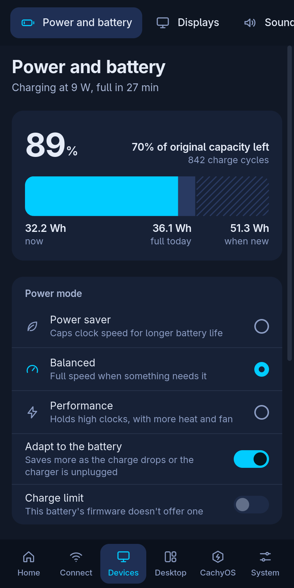
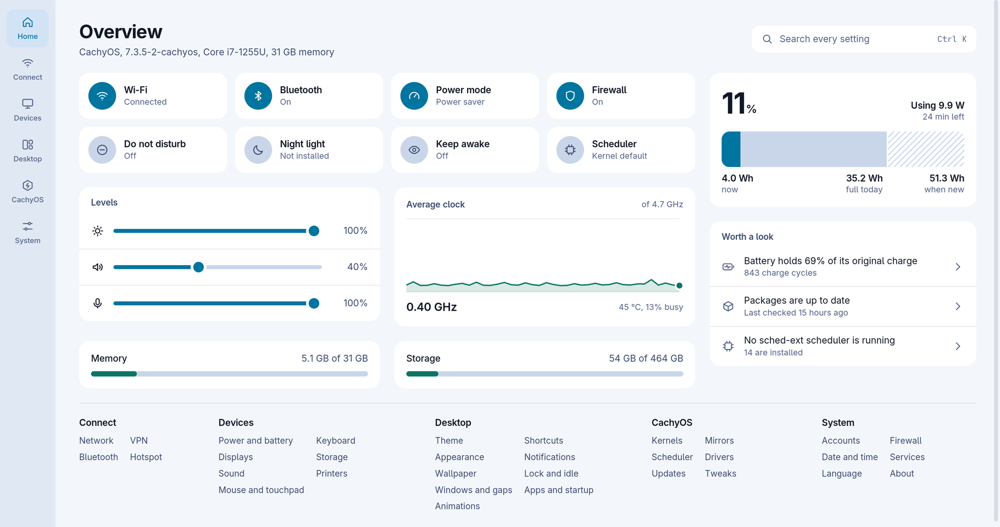
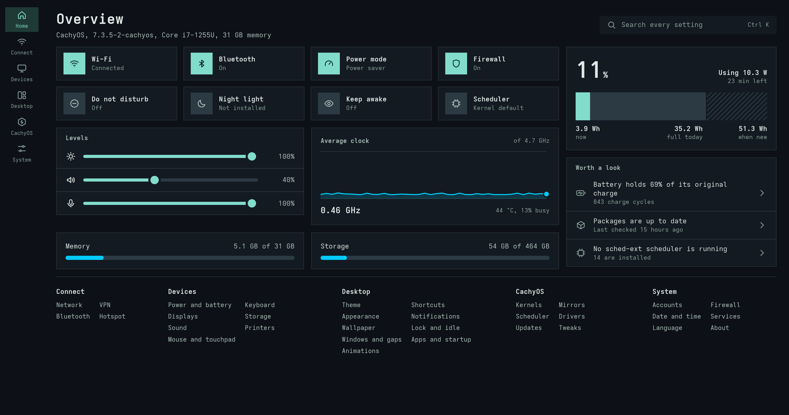
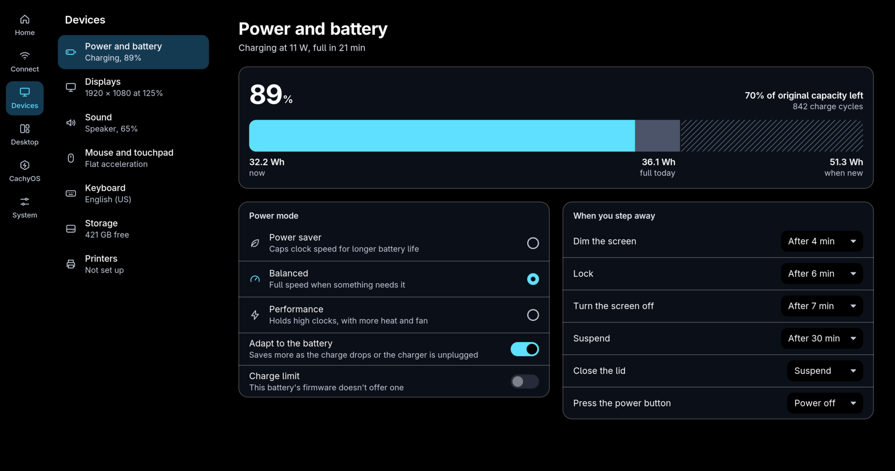

<div align="center">


# HyprKontrol

**A native settings application for CachyOS on Hyprland, written in Rust.**

It shows the command behind each change, and most changes can be undone.<br>
Every colour, font and corner can be themed.


[Features](#features) · [Install](#install) · [Themes](#themes) · [How it works](#how-it-works) · [Documentation](#documentation)



</div>

Hyprland is a compositor and does not come with a settings application. There are
good editors for its own options, but sound, networks, power, displays, kernels
and the rest of the system each live in a different tool or file. HyprKontrol puts all
of it in one window, uses the tools you already have, and never hides what it
does.

It is made for Hyprland. It is not a KDE application, and installing it does not
pull in any other packages.

## Features

<table>
<tr>
<td width="50%" valign="top">



### See what your battery has lost

The gauge is drawn against the capacity your battery had when it was new.
Power modes, idle timers, lid and power button sit on the same panel.

</td>
<td width="50%" valign="top">



### Tune Hyprland while you watch

Gaps, borders, corners and blur change on your desktop as you drag. Your own
Lua files are left alone: overrides live in one generated module.

</td>
</tr>
<tr>
<td width="50%" valign="top">



### Swap the CPU scheduler live

Start any installed sched-ext scheduler without a reboot, with the load of
every thread in view. Performance and efficient cores are told apart.

</td>
<td width="50%" valign="top">



### Make it yours

Sixteen colours, eleven measurements, fonts and every icon. The editor
previews changes as you make them and warns when text gets hard to read.

</td>
</tr>
</table>

### Built for tiling

The layout follows the width of its tile. The sidebar folds into a strip at half
a screen, and the rail becomes a bottom bar in a narrow column.

<div align="center">

&nbsp;&nbsp;

</div>

### What it covers

| Section | Panels |
| --- | --- |
| **Connect** | Network, Bluetooth, VPN, Hotspot |
| **Devices** | Power and battery, Displays, Sound, Mouse and touchpad, Keyboard, Storage, Printers |
| **Desktop** | Theme, Appearance, Wallpaper, Windows and gaps, Animations, Shortcuts, Notifications, Lock and idle, Apps and startup |
| **CachyOS** | Kernels, Scheduler, Updates, Mirrors, Drivers, Tweaks |
| **System** | Accounts, Date and time, Language, Firewall, Services, About |

Controls your hardware lacks are shown disabled, with the reason.

## Install

You need a Rust toolchain, version 1.88 or newer.

```sh
git clone https://github.com/lebelokamogelo/HyprKontrol.git
cd HyprKontrol
make build
sudo make install
```

This installs the program, a desktop entry and an icon below `/usr/local`. Use
`PREFIX` to choose another place, and `make uninstall` to remove them.

Open a panel directly by naming it, which is handy for keybindings:

```sh
hyprkontrol sound
hyprkontrol --list
```

Panels use whatever is installed. Nothing below is required to start the
program, and a panel whose tool is missing says so.

| Panel | Uses |
| --- | --- |
| Network, VPN, Hotspot | NetworkManager |
| Bluetooth, airplane mode | BlueZ, `rfkill` |
| Sound | PipeWire or PulseAudio, `pactl` |
| Power | `power-profiles-daemon`, `brightnessctl`, `hypridle` |
| Windows, Animations, Shortcuts, Displays, input | Hyprland with a Lua configuration |
| Wallpaper, Notifications | `hyprpaper`, `swaync` |
| Scheduler, Drivers, Mirrors | `scx-tools`, `chwd`, `cachyos-rate-mirrors` |
| Updates | `pacman-contrib` |
| Firewall | `ufw` |

## Themes

<table>
<tr>
<td width="33%"></td>
<td width="33%"></td>
<td width="33%"></td>
</tr>
<tr>
<td align="center">CachyOS Light</td>
<td align="center">Terminal</td>
<td align="center">High Contrast</td>
</tr>
</table>

A theme is one TOML file. It names a base and lists what is different:

```toml
name = "Ember"
author = "Your name"
base = "cachyos-dark"

[colors]
accent = "#ff8a3d"
on_accent = "#241000"

[metrics]
card_radius = 8
```

Save it in `~/.config/hyprkontrol/themes/` and it appears in the Theme panel.
Saved edits show within a second or two. Colours accept an alpha channel, so
Hyprland's blur can show through.

```sh
hyprkontrol --check-theme ember.toml
```

[Writing a theme](docs/THEMES.md) documents every value.

## How it works

**Commands are visible.** The bar at the bottom shows the command or file edit
behind the last change. Copy it into a script, or press Undo. Some things cannot
be taken back, such as installing packages or clearing a cache.

**Your files stay yours.** Edits to existing files touch only the lines they
must, keep comments, write through symlinks, and leave a copy of the original
the first time. [Configuration](docs/CONFIGURATION.md#files-it-writes) lists
every file that can be written.

**The program never runs as root.** Privileged changes go through polkit one at a time.

**Packages are handled in the window.** Updating, installing and removing show
their progress in place, with pacman's output one click away. Its questions are
yours to answer, and nothing is confirmed for you. Until packages start to be
changed you can stop at any time. AUR packages update in a terminal, where your
helper shows their build scripts.

**Risky changes time out.** A display mode that is not confirmed within 15
seconds is reverted, in case you can no longer see the screen.

**Passwords stay private.** Wi-Fi passwords are sent to NetworkManager over
D-Bus and never appear in a process listing.

**It is idle when you are not looking.** Panels refresh only while the window
has focus. Volume and brightness follow your keys through events, without
polling.

## Status

Version 0.1. It has been developed and tested on a single laptop with CachyOS,
Hyprland 0.57 and Intel graphics. Reading works on every panel there, and the
Hyprland save path is covered by a test against a running compositor.

These have had no testing on real hardware yet, and reports are welcome:

- joining Wi-Fi networks, hotspots, Bluetooth pairing and connecting to a VPN
- changes that ask for a password, and starting a scheduler
- installing and removing packages, kernels and drivers
- more than one display
- charge limits, AMD and NVIDIA systems
- Hyprland with the older `hyprland.conf`, where changes cannot be saved

The interface is in English, and iced does not support screen readers yet.

## Documentation

- [Writing a theme](docs/THEMES.md)
- [Configuration](docs/CONFIGURATION.md): preferences, shortcuts and files
- [Architecture](docs/ARCHITECTURE.md): how the code is organised, and how to add a panel
- [Contributing](CONTRIBUTING.md)

## Licence

[MIT](LICENSE). This is an independent project and not affiliated with CachyOS,
Hyprland or KDE.
